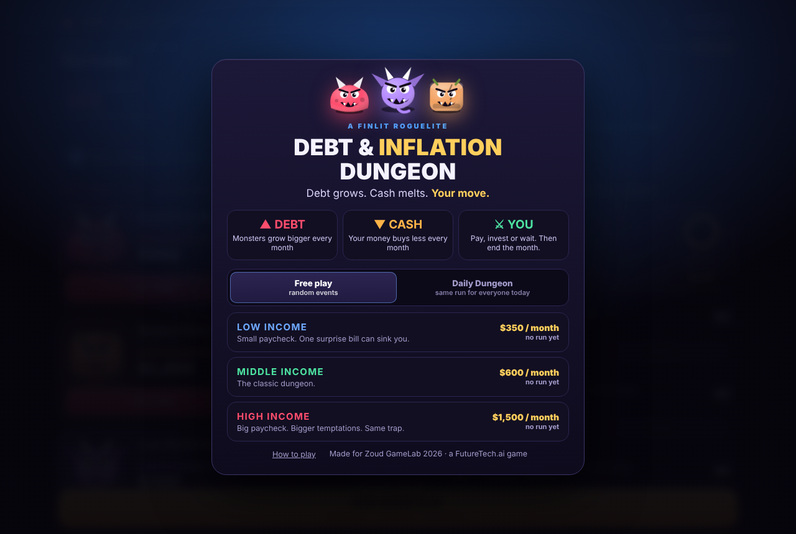

# Debt & Inflation Dungeon

**Debt grows. Cash melts. Your move.**

A financial-literacy roguelite you can learn in ten seconds and finish in five minutes. Debt monsters get bigger every month, your cash buys less every month, and life keeps throwing surprise bills at you. Rich or poor, the trap is the same, but smart decisions get you out.

Built for **Zoud GameLab 2026** (theme: *Make FinLit Fun*).



## Play

- **Browser:** open `index.html`, or visit the hosted page (see the repository's About link).
- No install, no build step, no dependencies. One HTML file.
- Works on desktop and phones. Keyboard, mouse and touch.

## How it works

You have 12 months. Each month you decide what to do with your cash, then press **END MONTH** and see what happens.

| What you see | What it teaches |
|---|---|
| Debt monsters grow by a visible % every month, with a ghost bar showing next month's size | Interest compounds on the whole balance |
| Your cash loses value every month, shown as a shrinking "buying power" ring | Inflation erodes idle money |
| Fastest-growing monster is flagged in the tutorial | The avalanche method: pay the highest rate first |
| Safety Net gauge (cash vs. a typical surprise bill) | Emergency funds |
| Surprise bills with no cash create a 15%-a-month Emergency Imp | The real cost of having no buffer |
| Three assets: steady, mixed, wild | Risk vs. return and diversification |
| Optional "everyone has one" purchases that feel reasonable | Status spending, and how credit makes it worse |
| "Income gap" events halve your next paycheck | The risk of a single income |

### Three paychecks, one trap

Pick **Low**, **Middle** or **High** income at the start. Numbers scale, the rules do not. High earners get bigger temptations and bigger debts, and they fall into the same trap.

### Daily Dungeon

A seeded mode: everyone who plays on the same day, at the same income level, gets exactly the same events and market swings. Compare scores fairly and share the result image.

### Scoring

★ survive 12 months · ★★ finish debt-free · ★★★ debt-free with high net worth. Seven unlockable "insights" (Avalanche Mind, Safety Net, Status Resister…) are saved in your browser.

## Controls

| Key | Action |
|---|---|
| `1`–`9` | Pay the nth monster (`Shift` = pay all) |
| `Enter` / `E` | End month |
| `?` | How to play |

## Accessibility

- Honors `prefers-reduced-motion` (no shake, particles or tweens).
- Information is never colour-only: arrows (▲ ▼), labels and numbers carry the meaning.
- Large touch targets, keyboard shortcuts, screen-reader announcements for each month.
- Sound can be muted; the choice is remembered.

## Tech

Vanilla HTML/CSS/JavaScript in a single file. Canvas for particles and the share card, SVG for monsters and charts, Web Audio for procedural sound and ambience. Progress is stored in `localStorage` (and the game works without it).

## Simulate and test

The balance is checked by playing thousands of automated games with different strategies (idle, avalanche, status-chasing, all-in on the wildest asset, …).

```bash
npm install
npm run simulate        # all tiers
node tests/simulate.js mid
```

Expected shape: doing nothing or going all-in on the wild asset loses; paying the fastest-growing debt first wins; chasing status leaves you in debt. The Daily Dungeon is verified to be deterministic.

## Documents

- [Game design document](docs/GDD.md)

## Credits

Design and code: Shahariar / FutureTech.ai. No open-source licence has been chosen yet. Zoud holds the jam's non-commercial display licence for the version submitted to Zoud GameLab; ownership remains with the creator.
