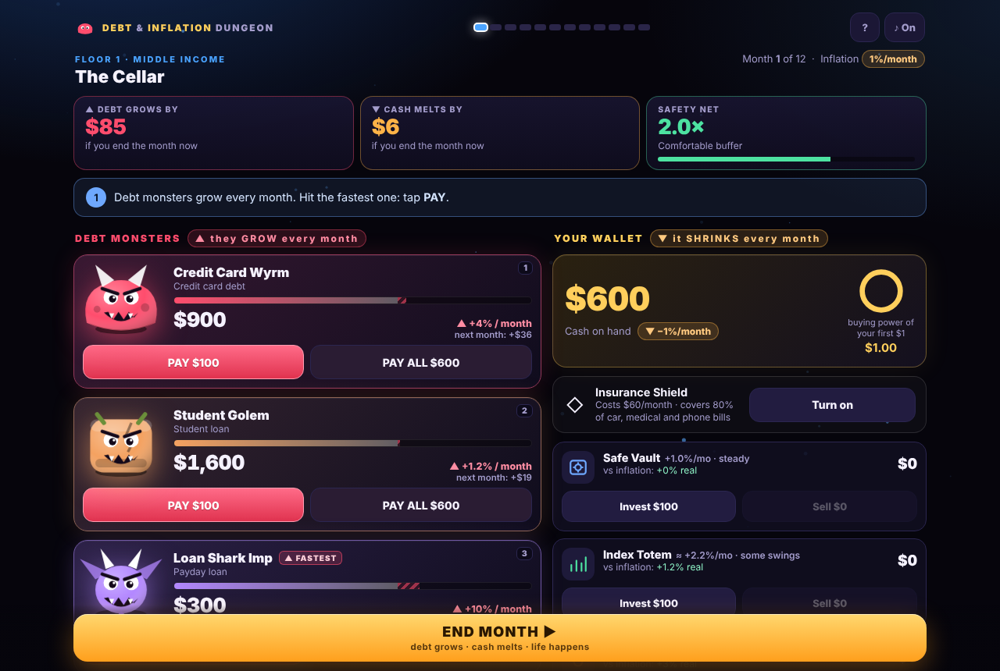
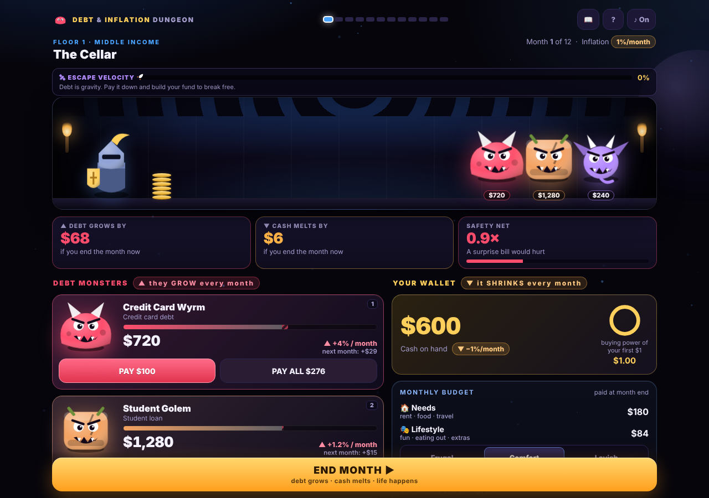
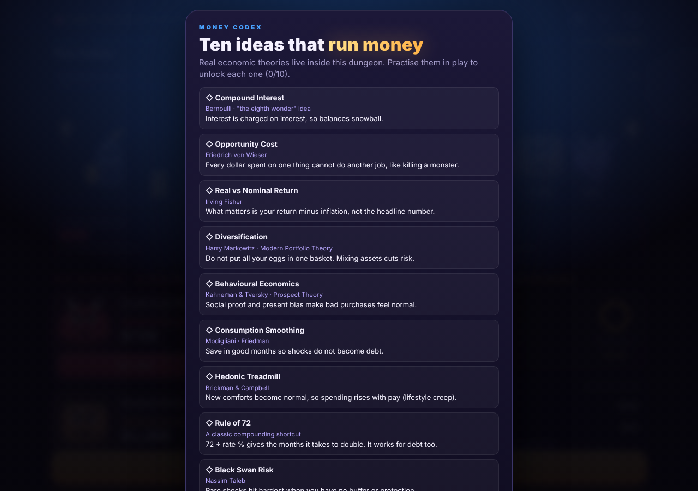
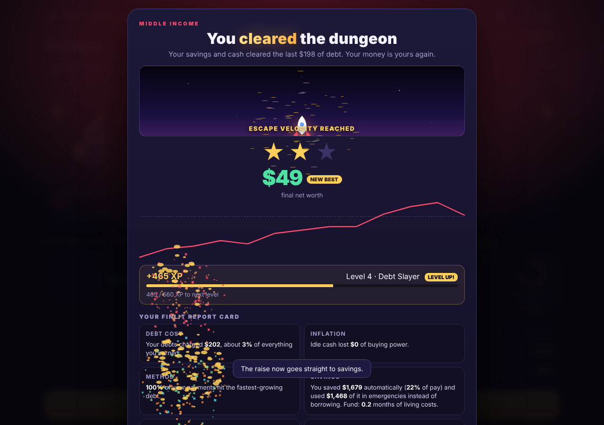
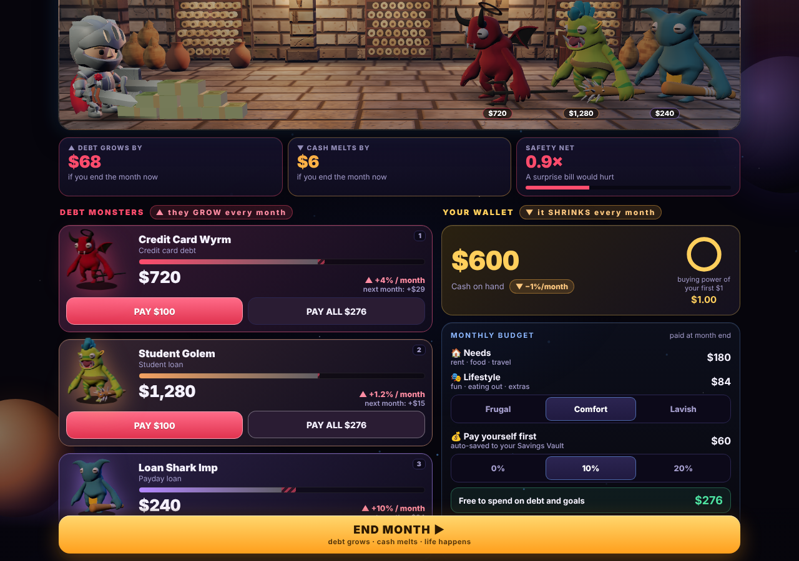

# Debt & Inflation Dungeon

**Debt grows. Cash melts. Your move.**

A financial-literacy roguelite you can learn in ten seconds and finish in five minutes. Debt monsters get bigger every month, your cash buys less every month, and life keeps throwing surprise bills at you. Rich or poor, the trap is the same, but smart decisions get you out.

Built for **Zoud GameLab 2026** (theme: *Make FinLit Fun*).








## Play

- **Browser:** open `index.html`, or visit the hosted page (see the repository's About link).
- No install, no build step, no dependencies. One HTML file.
- Works on desktop and phones. Keyboard, mouse and touch.

## How it works

You have 12 months. Each month you set a budget, put your free cash to work, then press **END MONTH** and see what happens.

| What you see | What it teaches |
|---|---|
| Debt monsters grow by a visible % every month, with a ghost bar showing next month's size | Interest compounds on the whole balance |
| Your cash loses value every month, shown as a shrinking "buying power" ring | Inflation erodes idle money |
| Fastest-growing monster is flagged in the tutorial | The avalanche method: pay the highest rate first |
| Safety Net gauge (cash vs. a typical surprise bill) | Emergency funds |
| A monthly budget: Needs are fixed, you choose Lifestyle (Frugal / Comfort / Lavish), and what is left is "free cash" | Budgeting: needs before wants |
| "Pay yourself first": 0 / 10 / 20% of pay moves to your Savings Vault automatically | Saving as a habit, not a leftover |
| A 3-month Emergency Fund goal. Savings automatically cover surprise bills; with none, a bill becomes a 15%-a-month Emergency Imp | Emergency funds, and the real cost of having no buffer |
| Two raises (months 4 and 8): upgrade your lifestyle, save it, or keep life the same | Lifestyle creep |
| Four assets: steady, mixed, wild, and the space-tech **Orbit Fund** (launch windows surge, launch failures crash) | Risk vs. return and diversification |
| **Escape Velocity** meter: debt is gravity; paying it down and building a fund lifts your rocket. Finale: rocket launch, stuck in orbit, or pulled into the debt singularity | Net-worth thinking, shown as a physical metaphor |
| **Money Codex**: eleven real economic ideas (compound interest, opportunity cost, Fisher real returns, Markowitz diversification, Kahneman behavioural bias, consumption smoothing, hedonic treadmill, Rule of 72, Taleb black swans, Becker human capital, rational choice) tagged in play and unlocked by how you play | Theory made practical |
| Optional "everyone has one" purchases that feel reasonable | Status spending, and how credit makes it worse |
| "Income gap" events halve your next paycheck | The risk of a single income |
| **Skill course** (months 2-7): borrow cheaply (1.5%/mo) or pay cash to raise pay 12%; taken early it pays back, taken late it does not | Good debt vs bad debt, human capital |
| **Arabic with right-to-left layout** (language button on the title screen) | Authentic regional access, not only a translation |
| **"What could have been"** on the end screen | Shows the interest and inflation your choices cost |
| **Gulf pack** (title screen toggle): remittances with hidden fees, pay-in-4 instalments, giving season, Eid hosting | Regional money life, hidden costs |
| Optional Insurance Shield: a monthly premium (10% of pay) covers 80% of car, medical and phone bills, but not rent rises or parties | Insurance: a small certain cost against a big uncertain one |

### Three paychecks, one trap

Pick **Low**, **Middle** or **High** income at the start. Numbers scale, the rules do not. High earners get bigger temptations and bigger debts, and they fall into the same trap.

### Daily Dungeon

A seeded mode: everyone who plays on the same day, at the same income level, gets exactly the same events and market swings. Compare scores fairly and share the result image.

### Levels and daily goal

Every run earns XP that carries across games (saved in your browser) and unlocks levels from Rookie to Dungeon Master. The Daily Dungeon also sets one goal per day (for example "finish without a single status purchase") for bonus XP.

### Scoring

★ survive 12 months · ★★ finish debt-free · ★★★ debt-free with high net worth. Eleven unlockable "insights" (Avalanche Mind, Pay Yourself First, Fortress, Creep Crusher…). At the end, cash and savings automatically settle remaining debt are saved in your browser.

## Controls

| Key | Action |
|---|---|
| `1`–`9` | Pay the nth monster (`Shift` = pay all) |
| `I` | Toggle insurance |
| `Enter` / `E` | End month |
| `?` | How to play |

## Accessibility

- Honors `prefers-reduced-motion` (no shake, particles or tweens).
- Information is never colour-only: arrows (▲ ▼), labels and numbers carry the meaning.
- Large touch targets, keyboard shortcuts, screen-reader announcements for each month.
- Sound can be muted; the choice is remembered.

## Tech

Vanilla HTML/CSS/JavaScript in a single file. Canvas for particles and the share card, SVG for monsters and charts, Web Audio for procedural sound and ambience. Progress is stored in `localStorage` (and the game works without it).

## Simulate and test

The balance is checked by playing thousands of automated games with different strategies (idle, avalanche, status-chasing, all-in on the wildest asset, …).

```bash
npm install
npm run simulate        # all tiers
node tests/simulate.js mid
```

Expected shape: doing nothing loses; lavish living plus status purchases loses; a frugal budget, paying the fastest-growing debt first and building an emergency fund wins; living lavishly leaves you in debt. The Daily Dungeon is verified to be deterministic.

## Documents

- [Game design document](docs/GDD.md)
- [2-minute video script](docs/VIDEO_SCRIPT.md)
- [Game budget and production plan](docs/BUDGET.md)
- [Submission pack](docs/SUBMISSION.md)

## Credits
Real-time 3D arena built with [three.js](https://threejs.org). All 3D art is CC0:
- Knight and dungeon pieces: [KayKit](https://kaylousberg.com) by Kay Lousberg (Adventurers 1.0, Dungeon Remastered 1.0)
- Monsters: [Quaternius](https://quaternius.com) (Demon, BlueDemon, Orc, CreepCreature)
Game code, design, UI, balance and music are original. See `assets/CREDITS.md`. If WebGL is unavailable the game falls back to a 2D arena.
